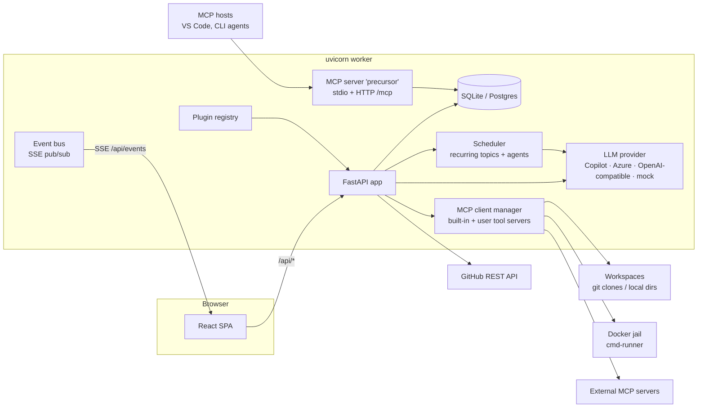

# Architecture

One uvicorn worker serves the JSON API and the built React SPA. There is **no
Node.js runtime in production**. An in-process scheduler and event bus run
beside the request handlers. Where new code goes, and the building blocks to
reuse, is in
[`ARCHITECTURE.md`](https://github.com/lrivallain/precursor/blob/main/ARCHITECTURE.md).

## Process model

Everything starts in `precursor/backend/main.py` (app factory + lifespan):

| Component | Where | Role |
| --- | --- | --- |
| FastAPI app | `main.py`, `routers/` | `/api/*`, the SPA at `/`, the docs at `/docs/`, MCP streamable HTTP at `/mcp` (gated, loopback-only). OpenAPI docs live at `/api/docs`, `/api/redoc`, `/api/openapi.json` ([why](/reference/api#serving-the-docs-in-app)). |
| Scheduler | `services/scheduler.py` | async ticker + bounded worker pool for scheduled topics and agents |
| Event bus | `services/events.py` | in-process pub/sub, fanned out to every window over `/api/events` |
| MCP session manager | `services/mcp/` | the `precursor` server's HTTP transport |

The version (CalVer from git tags) is at `GET /api/version` and `/api/health`;
`GET /api/version/check` reports a newer build on the active channel (read-only).

### Background app

`precursor service` supervises the same worker without a terminal
([user guide](/features/background-app)).

| Module | Role |
| --- | --- |
| `backend/supervisor.py` | spawns/stops the worker; writes `pid`/`port`/`url`/`version` to `runtime.json` in the data dir; `status` = that file + a liveness probe |
| `backend/autostart.py` | login items: launchd agent, systemd *user* unit, or Windows `Run` entry (via `pythonw`); one for the app, one for the tray |
| `backend/winproc.py` | Windows: hidden-console detached spawn, Ctrl+Break stop, Win32 liveness, single-instance tray |
| `backend/windows_updater.py` | finishes a Windows self-update from the base interpreter once app and tray released the tool env |
| `backend/tray.py` | `pystray` menu-bar control (`tray` extra); stateless, each action mirrors a `service` command |
| `services/updates.py` | detects `source` vs `uv-tool` installs and updates each in place |

`working_dir()` is the repo root for a checkout (its default database URL is
relative) and the data dir for an installed wheel. `instance_settings()` reads
`.env` from there, not from the caller's cwd.

## Request flow: streamed chat

1. `POST /api/topics/{id}/messages/stream` (or `/api/chats/{id}/…`).
2. `services/conversation_turn.py` persists the user `Message` (binding
   attachments), snapshots history, and resolves model, effort, budget and MCP
   settings from the conversation's `llm_selection`, else global defaults. An
   explicitly chosen provider that isn't configured fails visibly (no silent
   Mock). The system prompt adds the linked GitHub issue (body, recent comments,
   labels), skills and memory.
3. Enabled [MCP servers](/features/mcp) are opened and their tools advertised.
   An unreachable server still contributes its **stored** catalogue. The turn
   engine runs a **tool loop** (stream, collect tool calls, execute, append
   results, repeat) up to the max-rounds setting. A call hitting a server that
   needs an interactive sign-in raises the prompt and retries every 10 s while
   the window is open; unattended runs get a tool error instead.
4. Each round is trimmed to the token budget.
5. Reasoning, text deltas and tool events stream over SSE.
6. On end or stop, the reply is persisted in a **fresh DB session**
   (`persist_final_turn`), usage rows are written, and `message.changed` /
   `stream.ended` publish.

Other callers of the same engine:

| Caller | Path |
| --- | --- |
| Chats | identical flow |
| Scheduled topics, MCP `post_message` | `services/turn.py`, off the request path |
| [Workspace](/features/workspaces) assistant | same tool loop, history sent by the client, nothing stored |
| Step assessments | same tool loop with the chat's MCP servers; ephemeral; reviewer gate capped at *balanced* |
| One-shot features (`/refine`, summaries, naming, …) | `complete_once()`, no tools (see [below](#llm-provider-abstraction)) |

While a turn streams, [compaction](/features/context-compression) and
[rewind](/features/rewind) answer `409`. A rewind confirmed in the UI commits
after its undo grace (or before the next prompt) and only deletes rows the user
saw.

### Message permalinks

- Topics, chats and messages carry an immutable `public_id` (UUID). The SPA
  resolves `/topics/id/<uuid>` and `/chats/id/<uuid>`, then a shared controller
  handles `#message=<uuid>`: it pages older history if needed and focuses the
  exact row. Numeric ids stay internal cursors.
- Agents use `/agents/<uuid>#event=<link_id>`; `link_id` is independent of SDK
  rewind ids and survives archive hydration. Missing targets are reported, never
  substituted.
- The turn engine tells the model to cite exact supplied URLs. Agent sessions
  get up to 50 current-run message references (240-char excerpts) through the
  SDK's `on_user_prompt_submitted.additionalContext` hook. MCP transcript tools
  return permalinks too.

## Request flow: editable topic summary

`POST /api/topics/{id}/topic-summary/generate` snapshots the brief, builds
bounded context (conversation, scratchpad, filenames), releases the DB
connection while the model runs, and writes with compare-and-swap (`409` on a
concurrent change). User-owned briefs get a **proposal**, not an overwrite.
Reads carry a `revision` that review submissions must echo; per-hunk decisions
use `reviewed` indices. Changes emit `topic-summary.changed`. Unrelated to the
GitHub issue summary at `/api/topics/{id}/summary`.

## Database

Models in `precursor/backend/models/`, async SQLAlchemy 2.

| Model | Notes |
| --- | --- |
| `Topic` | self-referencing tree; "scheduled" when it has an enabled `TopicSchedule`; optional `collection_id` |
| `Collection` | name, slug, colour, optional GitHub repo override and default role; a protected **General** collection is seeded |
| `Chat` | quick or side chat; may link to a parent topic, a step or a step plan |
| `Message` | per topic/chat, cascade delete; roles `user`/`assistant`/`system`/`tool`; large tool results can be age-pruned |
| `TopicSummary` | the topic's editable [status brief](/features/topic-summary) and pending proposal |
| `ConversationArtifact` | workspace files linked to a chat or topic |
| `ToolApproval` / `ApprovalRule` | parked tool calls and standing allow/ask [rules](/features/approvals) |
| `TopicSchedule` / `AgentSchedule` / `Reminder` | recurrence rules + run state (lease/status); one-shot reminders |
| `AgentSession` / `AgentRun` | **definition / execution split** (see below) |
| `AgentTrigger` / `AgentArtifact` / `AgentBlueprint` | [orchestrator](/features/agents-mode/orchestration): triggers, per-run artifact blackboard, templates |
| `AgentState` / `WorkflowState` | durable key/value stores that survive re-runs ([agent](/features/agents-mode/artifacts-state#durable-state-the-private-scratchpad), [pipeline](/features/workflows/steps#pipeline-state-what-a-workflow-remembers)); only the key index enters a prompt |
| `AgentEventRecord` | archived agent timeline events |
| `Workflow` / `WorkflowStep` / `WorkflowRun` / `WorkflowRunStep` | pipelines and their runs |
| `StepPlan` / `Step` / `StepArtifactVersion` / `StepPlanFinalVersion` | [step plans](#step-plans) |
| `MeetingSession` / `MeetingSegment` / `MeetingInsight` / `MeetingAttachment` | [live sessions](/features/live-sessions) |
| `Role` | assistant [roles](/features/skills-memory) |
| `NoteDraft` / `NoteDraftAttachment` | the per-topic/chat notes scratchpad |
| `IQChunk` / `IQDirty` | [Precursor IQ](#precursor-iq) index and change queue |
| `UsageRecord` | the token-usage ledger |
| `Workspace` | git clone or plain folder |
| `Skill`, `Memory` | skill enablement; long-term notes injected into the system prompt |
| `Attachment` | metadata + `sha256`; bytes are content-addressed blobs on disk, deduped, GC'd at startup |
| `MCPServer`, `MCPToolCache` | user MCP servers; each server's last-known tool catalogue |
| `IssueContextCache` | GitHub issue summary/state/labels with a TTL |
| `AppSetting` | JSON key/value runtime settings and secrets (only `*_present` booleans are returned) |

`AgentSession` is the reusable definition (objective, model, role, capability
defaults, `public_id`, budget and retry governance). `AgentRun` is one
execution: status, `copilot_session_id`, counters, token meter, frozen
capability snapshot, `trigger`, and `workflow_run_id` / `workflow_run_step_id`
when a pipeline drove it. Runtime registries, the live SDK session, artifacts,
events and token accounting are keyed by **run**, so one agent can serve two
concurrent workflows. `AgentSession.current_run_id` points at the live run and
its execution columns mirror it for cheap list reads.

**Alembic owns the schema**: `init_db` runs `alembic upgrade head` on startup
(no `create_all`). An older build refuses to start on a database a newer build
migrated, and leaves it untouched.

## GitHub integration

`services/github_client.py` wraps the endpoints the app needs (issues,
comments, labels, create/update, post comment). Topic context is rebuilt every
turn and cached in `IssueContextCache`. Token resolution: saved token, then
`gh auth token`.

The target repository resolves via
`services/collections.resolve_topic_github_repo()`: topic `github_repo` →
collection's → global `github_repo` setting.

## LLM provider abstraction

`services/llm/base.py` defines the protocol: plain text streaming, a
tool-capable event stream, and `list_models()`. Providers are `ProviderSpec`
entries in `services/llm/registry.py`; `get_llm_provider(session)` builds the
active one per request, falling back to Mock when credentials are missing.

Shipped: **GitHub Copilot** (default), **Azure AI Foundry**, **OpenAI** (any
OpenAI-compatible gateway through its base URL), **Mistral AI**, **Hugging
Face**, **Ollama**, **Mock**. Adding one is a `ProviderSpec` plus an
implementation class.

| Concern | How |
| --- | --- |
| Per-conversation choice | nullable `llm_selection` on chats/topics, honoured by replies, retries, compaction, summaries, notes, naming and scheduled/MCP turns. Live/IQ one-shots, agents, workflows and the OpenAI relay keep the global/runtime selection. Model catalogues and caches are provider-scoped. |
| One-shot calls | `services/llm/one_shot.complete_once()` (`/gh-*` drafts, `/notes rephrase`, `/refine`, naming, summaries, live recap/analysis/translation). Commits the caller's session before the call, writes usage in its own session. Raises `LLMCallFailed`, mapped to `502` if uncaught. |
| Model categories | `model_fallbacks` setting: categories of ordered presets, each naming its provider (or `agents` for the Copilot SDK). `services/llm/fallback.py` retries recognised model/effort/context rejections **before the first event** and re-budgets history. `llm_model_category` / `agents_model_category` select a category as the default; explicit model overrides and pins win. The actual model is recorded in persistence and usage. See [Model alternatives](/guide/configuration#optional-model-alternatives). |
| Preset health | catalogue endpoints only (no inference); `catalog_provider` exposes a fallback to Mock; checked in `lib/modelPresetHealth.ts` |
| Copilot's two APIs | `github_copilot.py` routes each model to `/chat/completions` or the Responses API from its `supported_endpoints`; `_responses_compat.py` maps Responses back to the same events (`text_delta`, `reasoning_delta`, `tool_calls`, `usage`, `turn_done`). Unknown models try `/chat/completions` first, then Responses. |
| Reasoning | `reasoning_text` / `reasoning_content` / `reasoning` deltas and Responses reasoning summaries all become `reasoning_delta`; stored per round for display, never replayed to the model |
| Transient refusals | `open_stream_with_retry` (`_openai_compat.py`) retries Copilot's `400 model_not_available_for_integrator` while opening the stream (before any token); other 4xx raise immediately |
| Serving outward | the [OpenAI-compatible endpoint](/features/openai-endpoint) (`routers/openai_proxy.py`, `services/openai_proxy.py`) calls `stream_chat_with_tools` once (the client runs its own loop), passes sampling options as `request_options`, and reads the first event before answering so refusals become HTTP errors. Only providers with `ProviderSpec.openai_proxy` are relayed; Mock fallback → `503`. |

## MCP

Precursor is both an MCP client and server ([user guide](/features/mcp)).

- **Client** (`services/mcp/client.py`): `MCPClientManager` holds built-ins
  (`github`, `workiq` and the Agent 365 `workiq-*` servers, `playwright`,
  `fetch`, `drawio`, `cmd-runner`, `precursor`), plugin servers and user
  servers. Sessions are pooled per server across turns; `warmup.py` connects
  enabled servers in the background after startup; `tool_cache.py` persists
  each catalogue.
- **Server** (`services/mcp/precursor_server.py`, tools in
  `precursor_tools/`): exposes Precursor's data, gated per section by
  `mcp_expose` (off by default), over **stdio** and HTTP at `/mcp` (off by
  default, loopback-only, Host allowlist). Stdio children publish events back
  through [`POST /api/events/publish`](/reference/api#events-raised-in-a-subprocess).

## Precursor IQ

`services/iq/` maintains a retrieval index (`iq_chunks`) over topics, briefs,
messages, attachments, chats, agents, live sessions and memory. It serves the
⌘K palette (`/api/iq/*`) and the `retrieve` / `ask` MCP tools.

| Piece | How |
| --- | --- |
| Change capture | an `after_flush` hook upserts `(source_kind, source_id)` into `iq_dirty` in the writer's transaction; `indexer.drain` rebuilds changed chunks by content hash; `indexer.reconcile` catches bulk statements |
| Full text | FTS5 external-content table + triggers (SQLite), or weighted `tsvector` + GIN (Postgres); `alembic/env.py` hides them from autogenerate |
| Vectors (opt-in) | provider `embed()` → normalised 256-d float32, compared in-process from a cache |
| Ranking | Reciprocal Rank Fusion, title/recency boost, one passage per source, per-container cap; archived/deleted containers dropped |
| Ask | `ask.ask`: one `complete_once` over numbered excerpts, returns `[^n]` citations |

`services/iq/ticker.py` drains and embeds in the background (gated by
`scheduler_enabled`); retrieval runs a short bounded drain first.

## Scheduler

`services/scheduler.py`: one async ticker enqueues due `TopicSchedule` and
`AgentSchedule` rows; a bounded pool runs them with DB row leasing for crash
recovery. Prompts starting with a slash command dispatch to that command;
`/guard` gates a run behind a cheap MCP probe. The same ticker retries failed
agents (exponential backoff), sweeps orphaned `pending` agents
(`services/agents/fleet.py`) and enforces the concurrency governor. See
[Scheduler](/features/scheduler).

## Workspaces

A `Workspace` is a git clone or local directory.

- `services/workspace_git.py`: clone/fetch/pull/commit/push. Token injected per
  operation, never stored; paths, branches and revisions validated before git
  sees them; literal pathspecs; no terminal prompts.
- `services/workspace_fs.py`: every path goes through `safe_join` (no traversal,
  no `.git`). The `precursor` and `drawio` MCP servers use the same sandbox.
- `services/workspaces.py`: create/allocate logic shared by the REST router and
  MCP tools.

## Step plans

`models/step_plan.py`: a `StepPlan` freezes an ask and owns a tree of `Step`
rows, each with a Markdown artifact and `StepArtifactVersion` history (no ORM
relationships; services query by id).

- `services/step_plans.py`: tree and status rules (a step with accepted children
  is a group with derived status) and the grounding injected into step chats
  (ordinary `Chat` rows linked by `step_id` / `step_plan_id`).
- `services/step_plan_llm.py`: structured proposals and review via
  `complete_once`; drafts and consolidation are real chat turns.
- Approvals: for delegated plans, `approvals.build_gate` defaults discussions to
  the source's recorded autonomy, with rules in order discussion → source →
  global; an explicit discussion policy overrides it. The assessor is capped at
  *balanced*.
- Source trace: creating a topic- or chat-linked plan commits a UI-only
  `Message(kind="step_plan")` holding a versioned `StepPlanTraceData` snapshot
  of the ask ([shape](/reference/api#step-plans)). It is rendered as plain text
  and never reconstructed from `StepPlan.source_text`.
- Amendments: `amend_step_plan` checks source, `state_token` and run state under
  a per-plan lock (shared with run starts and archiving), appends steps, marks
  the final stale and reuses approved steps on the next run. Saving or restoring
  a different final reopens a completed plan. Workspace files are not
  versioned.
- The streaming turn fills in the source and user-message id for same-source
  `create_step_plan` / `amend_step_plan` calls; parked approvals keep that
  origin.
- SQLite doesn't enforce foreign keys: deleting a plan/step removes its chats
  and versions explicitly; deleting a topic or source chat detaches its plans.
  Changes publish `step-plan.changed`. See [Step by step](/features/step-by-step).

## SPA

Vite + React 19 + Tailwind, built to `frontend/dist` and bundled in the wheel.
HTTP through `src/lib/api.ts`, chat streams through `src/lib/sse.ts`,
cross-window sync through `/api/events`. Theme via CSS variables
(`light` / `dark` / `system`). Monaco is lazy-loaded (`lib/monaco.ts` wires
workers and derives its theme from those variables).

## Security & deployment model

::: warning Single-user, no auth
Precursor is a **single-user, local-first** app with **no authentication**.
Keep it bound to `127.0.0.1` (the default) or put your own authenticating
reverse proxy in front.
:::

- Anyone who can reach the port has full access to topics, settings and stored
  tokens.
- The [command runner](/features/command-runner) executes shell/python/node:
  keep the Docker jail on.
- [MCP over HTTP](/features/mcp) is off by default and loopback-only.
- A request that came through a tunnel or proxy (it carries `X-Forwarded-*`
  headers) is **remote**, even though the tunnel reaches Precursor on
  `127.0.0.1`. MCP over HTTP, the plugin installer and remote-access control
  never answer it. Once remote access is on, a remote device must be paired
  with a one-time code from the PC first
  ([ADR-0002](https://github.com/lrivallain/precursor/blob/main/docs/adr/0002-remote-ui-access.md)).
- Secrets live in the local DB and are **never echoed** (only `*_present`
  booleans), except the [OpenAI-compatible endpoint](/features/openai-endpoint)'s
  own key, shown in clear so it can be pasted into clients (endpoint off by
  default).
- `GET /raw/{slug}/{path}` serves workspace files unauthenticated, by design.

Vulnerability reporting:
[SECURITY.md](https://github.com/lrivallain/precursor/blob/main/SECURITY.md).
